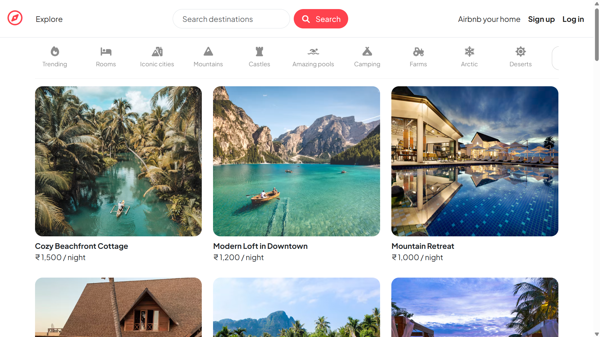
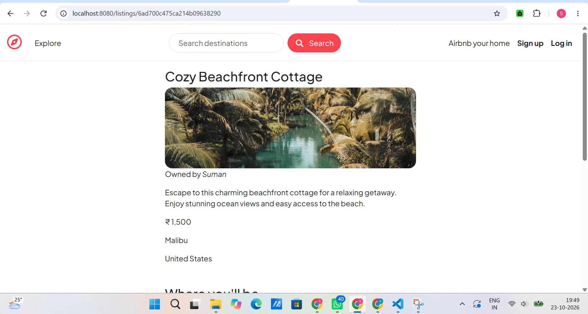
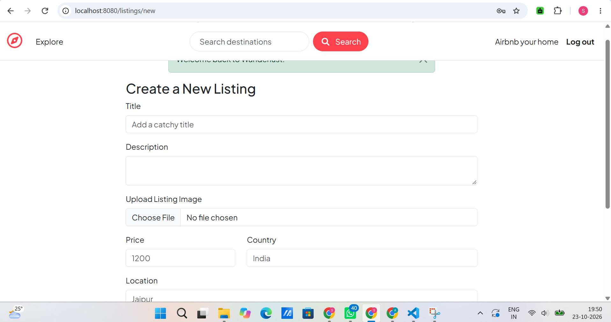
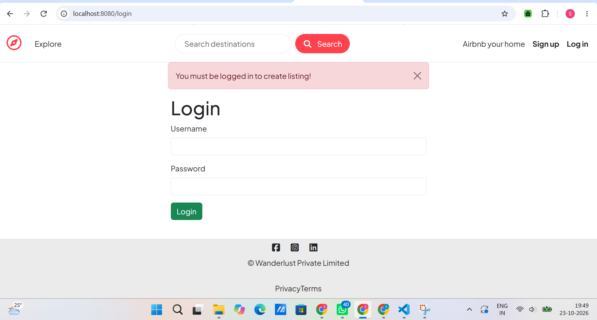
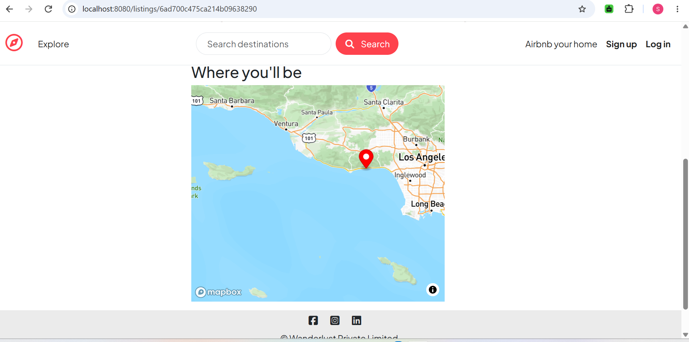
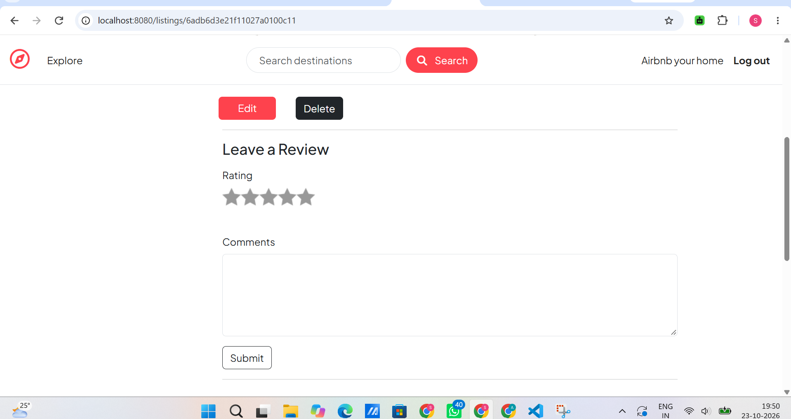

# 🏡 WanderLust — Discover Your Next Stay

WanderLust is a web application inspired by vacation-rental platforms, where users can explore property listings, view details, and discover places to stay.

## 📸 Screenshots

### Home Page


### Listing Details


### Create a Listing


### User Login


### Map View


### Reviews


## ✨ Features

- Browse property listings.
- View individual listing details.
- Create property listings.
- User authentication and login.
- Reviews and ratings.
- Map-based listing discovery.

*Keep only the features that are implemented and working in your project.*

## 🛠️ Tech Stack

- **Frontend:** HTML, CSS, JavaScript, EJS
- **Backend:** Node.js, Express.js
- **Database:** MongoDB, Mongoose
- **Version Control:** Git and GitHub

## ⚙️ Installation and Setup

### Prerequisites

Install Node.js and MongoDB, and ensure Git is available.

### 1. Clone the repository

```bash
git clone https://github.com/sumanraj-25/WanderLust.git
cd WanderLust
```

### 2. Install dependencies

```bash
npm install
```

### 3. Configure environment variables

Create a `.env` file in the project root and add the variables required by your application.

Example:

```env
ATLASDB_URL=your_mongodb_connection_string
SECRET=your_session_secret
```

Use the exact variable names expected by your application. Add any other required configuration, such as cloud storage or map API credentials, if applicable.

**Never upload your `.env` file or real API keys to GitHub.**

### 4. Start the application

Run the start command configured in your `package.json`. For example, if your application uses `app.js`:

```bash
node app.js
```

Open the local URL printed in your terminal.

## 📂 Project Structure

```text
WanderLust/
├── controllers/
├── init/
├── models/
├── public/
├── routes/
├── screenshots/
├── utils/
├── views/
├── app.js
├── cloudConfig.js
├── middleware.js
├── package.json
└── README.md
```

## 🎯 Project Objective

WanderLust demonstrates full-stack web development concepts, including server-side rendering, database integration, routing, user authentication, and CRUD operations.


## 🎥 Project Demo

Watch the WanderLust application demo:

[▶️ **Watch the Full Demo on YouTube**](https://youtu.be/ESPKEdJnLAI)


## 👨‍💻 Author

**Suman Raj**

GitHub: [@sumanraj-25](https://github.com/sumanraj-25)

---

If you find this project useful, consider giving the repository a ⭐.
